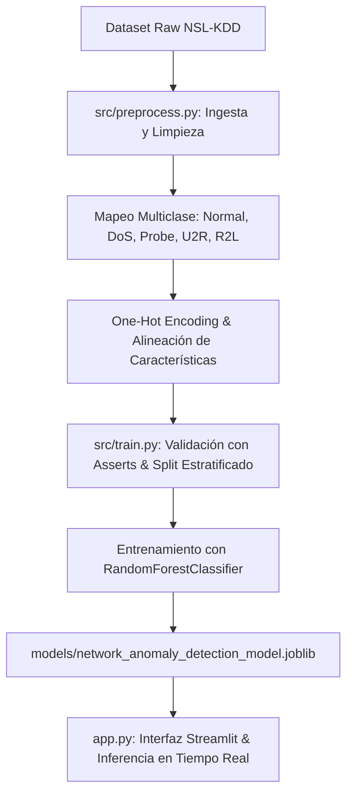

# Network Anomaly Detector (Random Forest & NSL-KDD)

Sistema de clasificación de tráfico de red en tiempo real (Normal vs. Ciberataques) utilizando aprendizaje automático con el algoritmo Random Forest, optimizado sobre el dataset benchmark NSL-KDD y empaquetado en una arquitectura modular de Scikit-Learn.

## Resultados del Modelo
- **F1-Score / Accuracy (Test set):** > 0.98
- **Dataset:** 125,973 registros de entrenamiento y 22,544 de prueba del NSL-KDD Dataset.
- **Métricas Clave:** Clasificación multiclase optimizada para mitigar falsos positivos en tráfico legítimo (normal) y clasificar con alta precisión amenazas DoS, Probe, U2R y R2L.

## Arquitectura del Pipeline



1. **Preprocesamiento y Limpieza:** Mapeo de subcategorías de ataque a 5 clases tácticas principales, tratamiento de valores nulos y aserciones estrictas de integridad de datos.
2. **Codificación y Transformación:** Aplicación de One-Hot Encoding para características categóricas (`protocol_type`, `service`) y alineación de las 34 variables cuantitativas de red.
3. **Clasificación:** Entrenamiento e inferencia multiclase mediante `RandomForestClassifier` optimizado con validación estratificada (`StratifiedKFold`).

## Instalación y Uso
1. Clonar el repositorio:
```bash
git clone https://github.com/ethan-carrillodealbornoz/network-anomaly-detector.git
cd network-anomaly-detector
````

2. Instalar dependencias:
    


```Bash
pip install -r requirements.txt
```

3. Ejecutar el pipeline completo de entrenamiento:
    


```Bash
python src/train.py
```

4. Usar Streamlit para la interfaz gráfica:
    


```Bash
streamlit run app.py
```

## Simulación Manual de Paquetes de Red

Para probar la capacidad de inferencia del modelo desde la interfaz gráfica, selecciona el modo **"Usar Valores Manuales de la Barra Lateral"** e introduce los siguientes parámetros:

- **✅ Tráfico Normal (HTTP):**
    
    - Duración: `0` | `src_bytes`: `215` | `dst_bytes`: `4500` | `count`: `1` | `srv_count`: `1` | `serror_rate`: `0.0` | Protocolo: `tcp` | Servicio: `http`
        
- **🚨 Ataque DoS (SYN Flood - Neptune):**
    
    - Duración: `0` | `src_bytes`: `0` | `dst_bytes`: `0` | `count`: `250` | `srv_count`: `250` | `serror_rate`: `1.0` | Protocolo: `tcp` | Servicio: `private`
        
- **🔍 Escaneo de Puertos (Probe - Nmap):**
    
    - Duración: `0` | `src_bytes`: `0` | `dst_bytes`: `0` | `count`: `150` | `srv_count`: `1` | `serror_rate`: `0.0` | Protocolo: `icmp` | Servicio: `eco_i`
        
- **🔑 Acceso No Autorizado (R2L - FTP):**
    
    - Duración: `15` | `src_bytes`: `180` | `dst_bytes`: `250` | `count`: `2` | `srv_count`: `2` | `serror_rate`: `0.0` | Protocolo: `tcp` | Servicio: `ftp`
        

> Tras ajustar los controles de la barra lateral, pulsa **"🔍 Analizar Tráfico"** para actualizar la predicción y el gráfico de probabilidades.

## Estructura del Repositorio

- `notebooks/`: Explicación teórica paso a paso y análisis exploratorio de datos.
    
- `src/`: Código modularizado para preprocesamiento (`preprocess.py`) y entrenamiento (`train.py`).
    
- `models/`: Artefacto del modelo entrenado (.joblib).
    
- `data/`: Dataset utilizado para el entrenamiento.
    
- `app.py`: Interfaz gráfica interactiva desarrollada con Streamlit.
    

## 📜 Licencia

Este proyecto está bajo la Licencia MIT. Consulta el archivo LICENSE para más detalles.